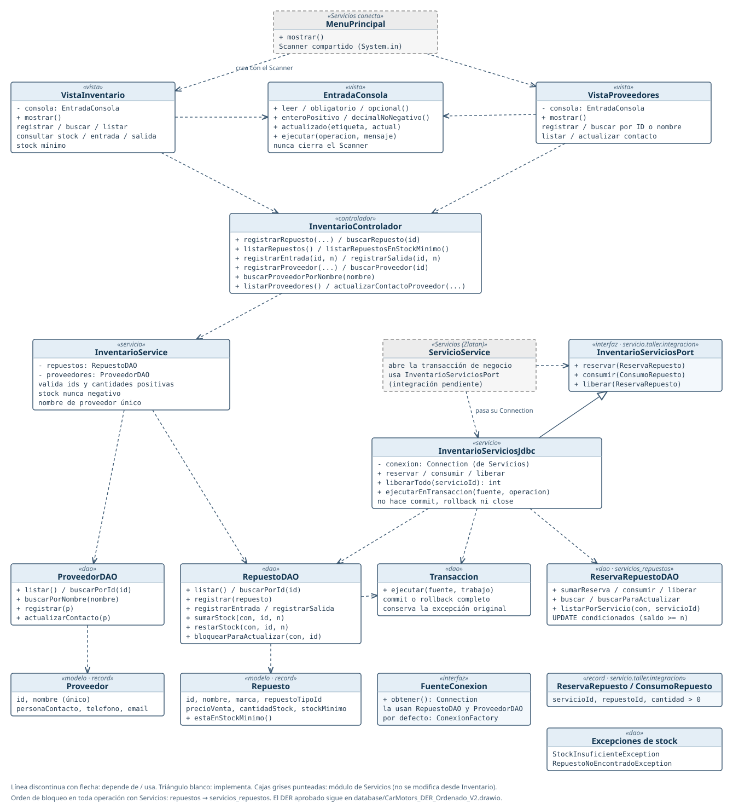

# Inventario y Proveedores en CarMotors

Este módulo controla los repuestos del taller, su stock y los proveedores. Además, entrega a Servicios las operaciones transaccionales para reservar, consumir y liberar repuestos de una orden.

- **Uso desde la consola:** `VistaInventario` y `VistaProveedores` (secciones 2 y 3).
- **Integración con Servicios:** `InventarioServiciosJdbc` (sección 5 y [integracion-servicios.md](integracion-servicios.md), donde están las decisiones aprobadas D1–D8).
- **Diagrama de clases:** [clases.svg](clases.svg) para verlo y [clases.drawio](clases.drawio) para editarlo en draw.io. El DER aprobado no cambia: sigue en [database/CarMotors_DER_Ordenado_V2.drawio](../../database/CarMotors_DER_Ordenado_V2.drawio).



## 1. Arquitectura

| Capa | Clase | Responsabilidad |
| --- | --- | --- |
| Vista | `VistaInventario` | Menú de repuestos y stock. Lee, valida el formato y muestra resultados o errores. |
| Vista | `VistaProveedores` | Menú de proveedores. Solo permite actualizar los datos de contacto. |
| Vista | `EntradaConsola` | Lectura validada compartida por las dos vistas: enteros, decimales, textos obligatorios u opcionales, y mensajes de error sin detalles internos de JDBC. **No cierra el `Scanner`.** |
| Controlador | `InventarioControlador` | Punto de entrada de las vistas. No contiene SQL. |
| Servicio | `InventarioService` | Reglas: ids y cantidades positivas, stock nunca negativo, nombre de proveedor único. |
| Servicio | `InventarioServiciosJdbc` | Implementa `InventarioServiciosPort` para Servicios dentro de la transacción que Servicios abre. |
| DAO | `RepuestoDAO`, `ProveedorDAO`, `ReservaRepuestoDAO` | SQL parametrizado sobre `repuestos`, `proveedores` y `servicios_repuestos`. |
| DAO | `Transaccion` | Commit o `rollback` completo y cierre de la conexión; conserva la excepción original. |
| Modelo | `Repuesto`, `Proveedor` | Records validados que reflejan las tablas de `database/bloques/inventario.sql`. |

## 2. Inventario de repuestos (`VistaInventario`)

| Opción | Qué hace |
| --- | --- |
| 1. Registrar repuesto | Pide nombre, marca, ID del tipo, precio de venta (punto decimal), stock inicial y stock mínimo. |
| 2. Buscar repuesto por ID | Muestra el repuesto o avisa que no existe. |
| 3. Listar repuestos | Lista todos los repuestos por ID y marca los que están en su stock mínimo. |
| 4. Consultar stock disponible | Muestra el stock disponible y el mínimo, y alerta si conviene reponer. |
| 5. Registrar entrada | Suma unidades al stock. |
| 6. Registrar salida | Resta unidades solo si alcanzan. Si no alcanzan, muestra el error y no cambia nada. |
| 7. Listar repuestos en stock mínimo | Lista los repuestos para reposición. |
| 0. Volver | Regresa al menú principal. |

Sesión real (salida de la consola, sin repetir el menú):

```text
Opción: 1
Nombre: Filtro de aceite
Marca: Bosch
ID del tipo de repuesto: 1
Precio de venta (punto decimal, por ejemplo 25000.50): 25000.00
Stock inicial: 10
Stock mínimo: 3
Repuesto registrado con ID 1.
Opción: 5   → ID 1, cantidad 5   → Entrada registrada. Stock actual: 15.
Opción: 6   → ID 1, cantidad 12  → Salida registrada. Stock actual: 3.
Opción: 6   → ID 1, cantidad 4   → Stock insuficiente: se pidieron 4 y hay 3 disponibles. No se registró el movimiento.
Opción: 4   → ID 1
Repuesto 1 | Filtro de aceite | Stock disponible: 3 | Stock mínimo: 3
(El stock disponible ya excluye las unidades reservadas para servicios.)
Alerta: el repuesto está en su stock mínimo o por debajo; conviene reponerlo.
```

El tipo de repuesto debe existir en `repuesto_tipos`. Si no existe, la vista responde *"La base de datos rechazó el repuesto: verifique que el tipo de repuesto exista."* y no guarda nada.

## 3. Proveedores (`VistaProveedores`)

| Opción | Qué hace |
| --- | --- |
| 1. Registrar proveedor | Nombre obligatorio y único (sin distinguir mayúsculas, igual que la columna `UNIQUE`). Contacto, teléfono y email son opcionales. |
| 2. Buscar por ID / 3. Buscar por nombre | La búsqueda por nombre usa el nombre exacto, sin espacios al inicio ni al final. |
| 4. Listar proveedores | Lista todos por ID. |
| 5. Actualizar contacto | Cambia persona de contacto, teléfono y email. **El nombre no se modifica**, porque es el dato único del proveedor. |

Al actualizar, cada dato muestra el valor actual: **Enter** lo conserva, **-** lo borra y cualquier otro texto lo reemplaza.

```text
Opción: 5
ID del proveedor: 1
Proveedor: AutoPartes SAS (el nombre no se modifica).
Persona de contacto [Laura Gómez] (Enter conserva, - borra):
Teléfono [3001234567] (Enter conserva, - borra): -
Email [ventas@autopartes.co] (Enter conserva, - borra): compras@autopartes.co
Contacto del proveedor actualizado.
Proveedor 1 | AutoPartes SAS | Contacto: Laura Gómez | Teléfono: sin registrar | Email: compras@autopartes.co
```

### Errores que muestran las dos vistas

| Situación | Mensaje |
| --- | --- |
| Opción o número inválido | `Opción inválida…`, `… debe ser un número entero.`, `… debe ser positivo.` |
| Regla del modelo o del servicio | `Validación: …` (por ejemplo, email inválido o precio que no cabe en `DECIMAL(10,2)`) |
| Proveedor repetido | `Error: Ya existe un proveedor con el nombre …` |
| Falla de conexión o SQL | `Error de base de datos. Revise la conexión y vuelva a intentarlo.` (sin detalles internos) |
| Fin de la entrada | La vista vuelve al menú que la llamó sin guardar la operación incompleta. |

Después de cualquier error, el menú sigue funcionando.

## 4. Reglas de stock

1. Toda entrada o salida necesita un repuesto existente y una cantidad positiva.
2. **El stock nunca queda negativo.** El servicio revisa el stock antes de la salida, y el DAO lo vuelve a comprobar dentro del `UPDATE … WHERE cantidad_stock >= ?`. Así, dos salidas simultáneas no pueden sacar más unidades de las que hay.
3. Cada entrada o salida usa su propia transacción. Si algo falla, se hace `rollback` y la base queda igual.
4. `cantidad_stock` es el **stock disponible**: ya excluye lo reservado para órdenes de servicio (decisión D2, opción A).
5. Un repuesto está en stock mínimo cuando `cantidad_stock <= stock_minimo`.

## 5. Reservas, consumos y liberaciones (integración con Servicios)

Servicios coordina la transacción e Inventario mueve el stock. Las reglas aprobadas son:

| Operación | Stock (`repuestos.cantidad_stock`) | Línea (`servicios_repuestos`) |
| --- | --- | --- |
| **Reservar** n | Baja n **una sola vez**. Si no alcanza, falla todo (sin reservas parciales, D3). | `cantidad_reservada + n`. Al crear la línea se fija el precio (D5). |
| **Consumir** n | **No cambia**: ya se descontó al reservar. | `cantidad_reservada − n`, `cantidad_usada + n`. No puede superar lo pendiente. |
| **Liberar** n | Sube n. | `cantidad_reservada − n`. `cantidad_usada` no cambia. |
| **Cancelar** (`liberarTodo`) | Sube todo lo pendiente. | `cantidad_reservada = 0`. Nunca devuelve lo usado (D8). |

Ejemplo aprobado de D1 (`cantidad_reservada` es lo pendiente de consumir), con stock inicial de 10:

| Paso | Stock | Reservada | Usada |
| --- | --- | --- | --- |
| Reservar 5 | 5 | 5 | 0 |
| Consumir 2 | 5 | 3 | 2 |
| Liberar 3 | 8 | 0 | 2 |

**Transacciones:** el adaptador recibe la `Connection` de Servicios con `autoCommit` desactivado y nunca hace `commit`, `rollback` ni `close`. Si una operación falla, Servicios deshace toda la transacción: sus propios cambios y los de Inventario. `ejecutarEnTransaccion` lo hace automáticamente.

**Bloqueos:** todas las operaciones bloquean primero la fila de `repuestos` y después la línea de `servicios_repuestos`, para evitar interbloqueos.

```java
// Servicios: una orden reserva dos repuestos y actualiza su estado en una sola transacción.
InventarioServiciosJdbc.ejecutarEnTransaccion(ConexionFactory::obtenerConexion, (conexion, inventario) -> {
    // ... cambios propios de Servicios con la MISMA conexion ...
    inventario.reservar(new ReservaRepuesto(servicioId, 1, 2));   // en orden ascendente de repuesto_id
    inventario.reservar(new ReservaRepuesto(servicioId, 2, 4));
    return null;
}); // commit si todo sale bien; rollback completo ante cualquier excepción

// Al usar las piezas (otra transacción de Servicios):
InventarioServiciosJdbc.ejecutarEnTransaccion(ConexionFactory::obtenerConexion, (conexion, inventario) -> {
    inventario.consumir(new ConsumoRepuesto(servicioId, 1, 2));
    return null;
});

// Al cancelar la orden: Servicios bloquea antes la fila del servicio y libera lo pendiente.
int devueltas = InventarioServiciosJdbc.ejecutarEnTransaccion(ConexionFactory::obtenerConexion,
        (conexion, inventario) -> inventario.liberarTodo(servicioId));
```

| Error | Significado |
| --- | --- |
| `StockInsuficienteException` | No hay stock para reservar. |
| `RepuestoNoEncontradoException` | El repuesto no existe. |
| `NoSuchElementException` | El servicio no tiene reserva de ese repuesto. |
| `IllegalStateException` | Se pide más que lo pendiente, la conexión está en `autoCommit` o falló JDBC (la `SQLException` queda como causa). |

### Dependencias entre Inventario y Servicios

- **Servicios → Inventario:** `ServicioService` usará `InventarioServiciosPort`, implementado por `InventarioServiciosJdbc`, y le pasa su conexión. Ese cableado lo hace Zlatan; Inventario no modifica Servicios.
- **Inventario → Servicios:** usa los records `ReservaRepuesto` y `ConsumoRepuesto` y la interfaz del paquete `servicio.taller.integracion`, sin cambiarlos. Solo escribe en `servicios_repuestos`; nunca en `servicios`.
- **Base de datos:** `inventario.sql` debe cargarse antes que `servicios.sql`, porque `servicios_repuestos.repuesto_id` referencia `repuestos.id`. No se agregaron columnas ni tablas.

## 6. Conexión al menú principal (para Zlatan)

Las vistas son independientes y **no se modificó `MenuPrincipal`**, para no pisar el PR #67 de Crisbely (Vehículos). Después de fusionar el PR #67, este es el cambio exacto:

```diff
+import com.carmotors.controlador.InventarioControlador;
 import com.carmotors.controlador.ServicioControlador;
 import com.carmotors.controlador.VehiculoControlador;
@@
             VistaVehiculos vehiculos = new VistaVehiculos(
                     entrada, System.out, new VehiculoControlador());

+            InventarioControlador inventarioControlador = new InventarioControlador();
+            VistaInventario inventario = new VistaInventario(
+                    entrada, System.out, inventarioControlador);
+            VistaProveedores proveedores = new VistaProveedores(
+                    entrada, System.out, inventarioControlador);
+
@@
                         2. Vehículos
+                        3. Inventario
+                        4. Proveedores
                         0. Salir""");
@@
                     case "2" -> vehiculos.mostrar();
+                    case "3" -> inventario.mostrar();
+                    case "4" -> proveedores.mostrar();
                     default -> System.out.println(
-                            "Opción inválida. Elija 1, 2 o 0.");
+                            "Opción inválida. Elija un número entre 0 y 4.");
```

En `MenuPrincipalTest` (PR #67) hay que actualizar el texto esperado `"Opción inválida. Elija 1, 2 o 0."` y conviene agregar una prueba de navegación, por ejemplo:

```java
@Test
void navegaPorInventarioYProveedoresSinBaseDeDatosYVuelveAlMenu() {
    String salida = ejecutarMain("3\n2\nx\n0\n4\n2\n0\n0\n0\n");
    assertTrue(salida.contains("=== Inventario ==="), salida);
    assertTrue(salida.contains("ID del repuesto debe ser un número entero."));
    assertTrue(salida.contains("=== Proveedores ==="));
    assertTrue(salida.contains("ID del proveedor debe ser positivo."));
    assertEquals(3L, salida.lines().filter(linea -> linea.contains("=== CarMotors SGT ===")).count());
}
```

**Verificado el 19/11/2026** en una copia aparte que se descartó: `develop` + PR #67 + esta rama se fusionan sin conflictos. Con el cambio anterior, `mvn clean verify` pasa 234 pruebas, 0 fallos y 0 omitidas (Java 17, MySQL 8.0.46 desechable).

Las vistas comparten el `Scanner` del menú y no cierran `System.in`. Cuando la entrada se acaba, vuelven al menú, que termina normalmente.

## 7. Evidencia de pruebas

Comando: `mvn clean verify` con Java 17.0.21 y Maven 3.9.11. Las pruebas JDBC solo corren si existe `CARMOTORS_TEST_DB_URL` y usan bases desechables `carmotors_prueba_<aleatorio>` que se crean y eliminan en cada prueba. Nunca tocan la base `carmotors`.

| Funcionalidad | Clases de prueba | Ejecutadas | Aprobadas | Fallidas | Omitidas sin MySQL |
| --- | --- | --- | --- | --- | --- |
| Vistas de consola de Inventario y Proveedores | `VistaInventarioTest`, `VistaProveedoresTest`, `VistasInventarioIntegracionTest` | 21 | 21 | 0 | 2 |
| Reservas, consumos, liberaciones, cancelación, rollback, concurrencia y conexiones | `InventarioServiciosJdbcTest`, `InventarioServiciosJdbcIntegracionTest` | 29 | 29 | 0 | 22 |
| Transacciones y movimientos de stock | `TransaccionTest`, `RepuestoDAOTransaccionTest`, `RepuestoDAOTransaccionIntegracionTest`, `RepuestoDAOTest`, `RepuestoDAOIntegracionTest` | 28 | 28 | 0 | 13 |
| Proveedores (DAO) | `ProveedorDAOTest`, `ProveedorDAOIntegracionTest` | 10 | 10 | 0 | 7 |
| Reglas de negocio y controlador | `InventarioServiceTest`, `InventarioControladorTest`, `InventarioFlujoIntegracionTest` | 31 | 31 | 0 | 3 |
| Modelos | `RepuestoTest`, `ProveedorTest` | 17 | 17 | 0 | 0 |
| Base de pruebas desechable | `EsquemaInventarioPruebaTest` | 3 | 3 | 0 | 3 |
| **Total Inventario y Proveedores** | | **139** | **139** | **0** | **50** |
| Resto del proyecto | otros módulos | 75 | 75 | 0 | 0 |
| **Total del proyecto** | | **214** | **214** | **0** | **50** |

Las pruebas detectan errores reales. Se comprobó con mutaciones temporales, revertidas después:

| Error introducido a propósito | Resultado |
| --- | --- |
| `consumir` sin bloquear primero el repuesto | Interbloqueo de MySQL en 3 de 3 ejecuciones. Así se encontró y corrigió el error del cierre. |
| La transacción no cierra la conexión | La prueba de conexiones detecta 40 conexiones abiertas. |
| Consumir vuelve a descontar stock (fase anterior) | 6 fallos. |
| Liberar sin condición de saldo (fase anterior) | 1 fallo y 1 error. |

La clase de integración del adaptador se repitió 10 veces: 10 de 10 sin fallos.

| Verificación final | Prueba que lo demuestra |
| --- | --- |
| No se permite stock negativo | `unaSalidaSinStockSuficienteMuestraElErrorYNoCambiaNada`, `RepuestoDAOTransaccionIntegracionTest` (20 salidas simultáneas sobre 10 unidades: se aceptan exactamente 10) |
| Las reservas simultáneas no asignan de más | `reservasConcurrentesNuncaComprometenMasUnidadesDeLasDisponibles` |
| Consumir no descuenta dos veces | `unConsumoParcialPasaUnidadesAUsadasSinVolverADescontarStock`, `ejemploAprobadoD1ReservarCincoConsumirDosYLiberarElResto` |
| Liberar devuelve solo lo pendiente | `liberarDevuelveSoloLoNoConsumidoYNoAlteraLoUsado`, `noSePuedeLiberarMasQueElSaldoPendiente` |
| Un rollback revierte todo | `siFallaUnaOperacionSeDeshaceTodaLaTransaccionDeNegocio`, `TransaccionTest` |
| No hay fugas de conexiones | `noQuedanConexionesAbiertasTrasOperacionesCorrectasYFallidas` |
| Las vistas funcionan con entradas válidas e inválidas | `VistaInventarioTest`, `VistaProveedoresTest`, `VistasInventarioIntegracionTest` |
| Compatible con Java 17 | Compilación y pruebas con JDK 17.0.21; GitHub Actions (`Java CI`) |

## 8. Ejecución

Se necesitan Java 17, Maven y MySQL con los bloques `inventario.sql` (antes) y `servicios.sql`, y al menos un tipo de repuesto en `repuesto_tipos`. La conexión de la aplicación sale de `com.carmotors.config.ConexionFactory`. Para las pruebas JDBC se usan una URL y un usuario de una instancia de pruebas:

```bash
CARMOTORS_TEST_DB_URL="jdbc:mysql://localhost:3306/" CARMOTORS_TEST_DB_USER=<usuario_pruebas> \
CARMOTORS_TEST_DB_PASSWORD=<clave_pruebas> mvn clean verify
```

## 9. Pendientes reales

| Pendiente | Responsable |
| --- | --- |
| Conectar `VistaInventario` y `VistaProveedores` a `MenuPrincipal` después del PR #67 (cambio listo en la sección 6). | Zlatan (Servicios / menú) |
| Usar `InventarioServiciosJdbc` desde `ServicioService` y `ServicioControlador`. | Zlatan |
| Lotes y devoluciones (D4): fuera de esta entrega. | Fase posterior |
| Revisar la compatibilidad con `database/esquema/esquema.sql` cuando se publique (hoy no existe en ninguna rama). | Valeria, cuando se publique |
| No hay pantalla para los tipos de repuesto: el registro pide el ID de un tipo que ya debe existir en `repuesto_tipos`. Las tablas `lotes`, `proveedores_repuestos` y `evaluaciones_proveedor` no tienen código Java. | Fuera de esta entrega |
