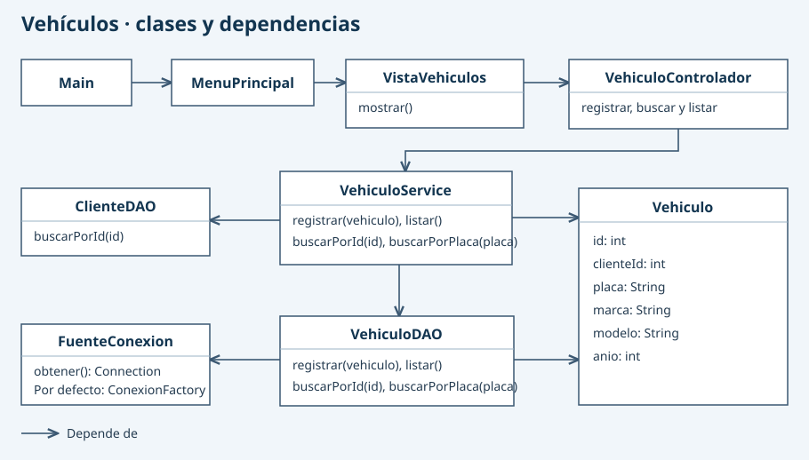

# Vehículos en CarMotors

El módulo registra vehículos asociados a clientes y permite consultarlos por ID, por placa o mediante el listado ordenado por ID. En la consola se abre con **2. Vehículos**. La opción **0** vuelve al menú principal, desde donde se puede entrar a **1. Servicios** o **0. Salir**.



El archivo `clases.svg` es la imagen exportable y también la fuente vectorial editable. Describe las dependencias Java del módulo. El DER aprobado sigue en [database/CarMotors_DER_Ordenado_V2.drawio](../../database/CarMotors_DER_Ordenado_V2.drawio).

## Arquitectura MVC

| Clase | Responsabilidad |
| --- | --- |
| `Main` y `MenuPrincipal` | Arrancan la consola y comparten el mismo lector de entrada con las vistas de Vehículos y Servicios. |
| `VistaVehiculos` | Pide datos, valida la sintaxis de la entrada y presenta resultados o errores. Devuelve el control al menú al elegir 0 o llegar al fin de entrada. |
| `VehiculoControlador` | Expone registro, búsqueda por ID y placa, y listado. Delega cada operación. |
| `VehiculoService` | Aplica reglas de cliente, placa, marca, modelo y año, normaliza placas y consulta duplicados. |
| `VehiculoDAO` | Ejecuta SQL parametrizado, recupera la clave generada, convierte filas a objetos y cierra recursos JDBC. |
| `Vehiculo` | Representa ID, cliente, placa, marca, modelo y año. |
| `ClienteDAO` | Comprueba la existencia del cliente durante el registro. |
| `ConexionFactory` y `FuenteConexion` | Proporcionan la conexión por defecto y permiten inyectar la fuente JDBC del DAO en pruebas. |

### Registro y consulta

1. La vista lee ID del cliente, placa, marca, modelo y año. Los errores de validación regresan al submenú y el fin de entrada interrumpe la operación.
2. El controlador pasa la solicitud al servicio. Este comprueba que el cliente existe, normaliza la placa y valida la unicidad, los campos de texto y el año (de 1900 al próximo año calendario). Marca y modelo admiten hasta 50 caracteres.
3. El DAO inserta en MySQL y recupera el ID. La vista presenta el resultado.
4. Para consultar, el servicio valida el ID positivo o normaliza la placa. El DAO devuelve el registro si existe y la vista informa cuando falta. El listado muestra todos los registros ordenados por ID, o un mensaje de lista vacía.

## Relaciones SQL

- `vehiculos.cliente_id` referencia `clientes.id`. Cada vehículo tiene un cliente obligatorio. Un cliente puede tener varios vehículos.
- `servicios.vehiculo_id` referencia `vehiculos.id`. Cada orden pertenece a un vehículo y este puede tener varias órdenes.
- `vehiculos.placa` es obligatoria, única y admite hasta 10 caracteres en el DDL.

Los bloques de [Clientes](../../database/bloques/clientes.sql), [Vehículos](../../database/bloques/vehiculos.sql) y [Servicios](../../database/bloques/servicios.sql) definen estas restricciones. Para este módulo se requiere crear primero la tabla `clientes` y luego `vehiculos`. Los recordatorios se crean después de sus tablas referenciadas. El bloque completo de Servicios requiere también `repuestos`.

## Ejecución

Usa Java 17, Maven y MySQL. La aplicación toma la configuración de `com.carmotors.config.ConexionFactory`, cuyo destino actual es `jdbc:mysql://localhost:3306/carmotors`. Usa una instancia de desarrollo con las tablas y al menos un cliente registrado. Mantén las credenciales locales fuera del control de versiones. Si el entorno requiere otro destino JDBC, configura una copia local de la factoría para la ejecución.

```bash
mvn compile
java -cp "target/classes:$HOME/.m2/repository/com/mysql/mysql-connector-j/9.5.0/mysql-connector-j-9.5.0.jar" com.carmotors.Main
```

Para reproducir el recorrido manual, entra a Vehículos, lista, registra con un ID de cliente existente, consulta por el ID devuelto y por la placa, vuelve al menú principal, entra a Servicios y Técnicos, regresa y sal con 0. Prueba también una opción inválida y un ID igual a cero.

## Pruebas y evidencia

```bash
export CARMOTORS_TEST_DB_URL=jdbc:mysql://127.0.0.1:33367/
export CARMOTORS_TEST_DB_USER=usuario_de_pruebas
# Configura CARMOTORS_TEST_DB_PASSWORD en tu entorno local.
mvn clean verify
```

Inicia primero una instancia MySQL de pruebas en ese puerto o ajusta la URL al servidor aislado. La cuenta debe poder crear y eliminar bases `carmotors_prueba_*` y operar en ellas. Cada prueba JDBC de Vehículos crea su propio esquema aleatorio, aplica el CREATE de `clientes` y el bloque de Vehículos del repositorio y elimina el esquema al terminar. La suite omite las pruebas JDBC cuando no está definida la URL. El adaptador de Clientes para las pruebas consulta la tabla real de clientes en el esquema desechable. La comprobación manual también ejercitó el `ClienteDAO` de producción.

| Ejecución del 19/11/2026 | Total | Aprobadas | Fallidas | Omitidas |
| --- | ---: | ---: | ---: | ---: |
| Suite Maven completa con Java 17.0.7 y MySQL 8.0.46 | 166 | 166 | 0 | 0 |
| JDBC real dentro de la suite completa | 25 | 25 | 0 | 0 |
| JDBC real de Vehículos | 4 | 4 | 0 | 0 |
| Vista de Vehículos y navegación desde Main | 16 | 16 | 0 | 0 |

Las pruebas JDBC verifican datos persistidos entre conexiones, claves generadas, búsquedas y listado, rechazo de duplicados y claves foráneas, rechazo real de autenticación y cierre de recursos. Las pruebas de consola cubren operaciones consecutivas, entradas inválidas, errores JDBC, navegación a Servicios y Técnicos y fin inesperado de entrada.

La comprobación manual arrancó `Main` con una factoría JDBC temporal en el classpath para apuntar a la instancia desechable. Registró el vehículo `ABC123` con ID 1, lo recuperó por ID y por placa, lo listó, volvió al menú y entró a Servicios y Técnicos antes de salir. Otra ejecución de `Main` recuperó la misma fila y una consulta directa en MySQL confirmó sus datos.

## Formato de placa e integración

- El equipo aprobó provisionalmente para esta entrega la regla de 5 a 10 caracteres ASCII alfanuméricos. La regla puede requerir ajustes futuros según los formatos de placa admitidos, incluidos los separadores y las variantes por tipo de vehículo. La conversión a mayúsculas usa `Locale.ROOT` para que el resultado sea estable entre equipos.
- El menú de la rama base expone Servicios y Vehículos. Los cambios revisados de Recordatorios y de Inventario están en los PR [#54](https://github.com/zlatanvillamizar/proyecto-java-grupo03/pull/54), [#61](https://github.com/zlatanvillamizar/proyecto-java-grupo03/pull/61) y [#62](https://github.com/zlatanvillamizar/proyecto-java-grupo03/pull/62). Sus cambios revisados no editan este menú.
- Para incorporar más vistas, la propuesta es que Zlatan acuerde con Mary y Valeria la numeración y las dependencias antes de editar el menú compartido. Cada opción delegaría en la vista de su módulo con el mismo lector y salida, y ampliaría la prueba de navegación. Las opciones 1, 2 y 0 se conservan durante esa incorporación.
- La conexión por defecto de la aplicación sigue configurada en código compartido. La prueba JDBC de Vehículos permite apuntar a otro servidor mediante la fuente inyectada.
